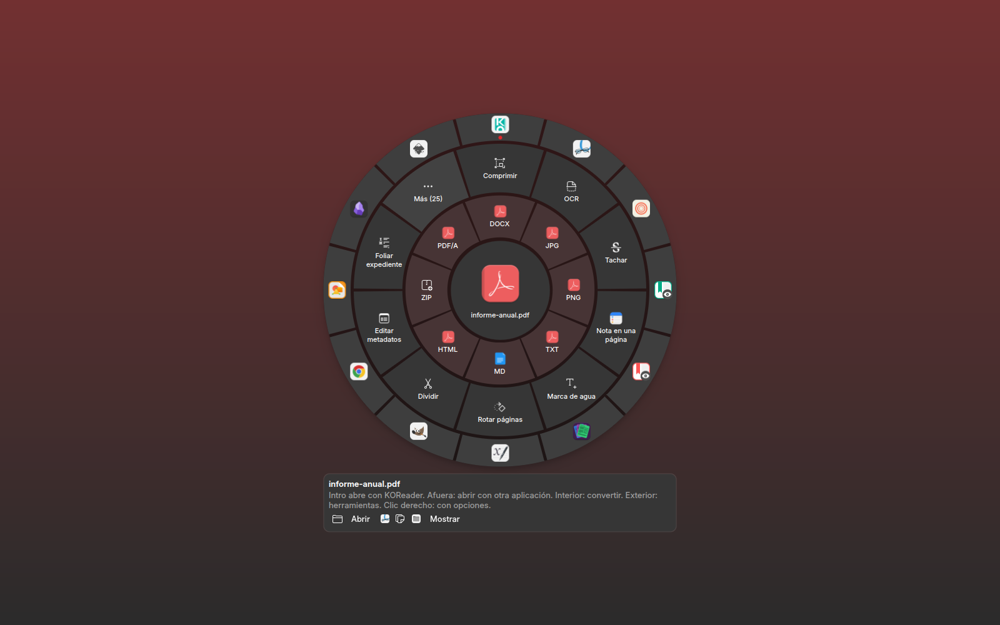
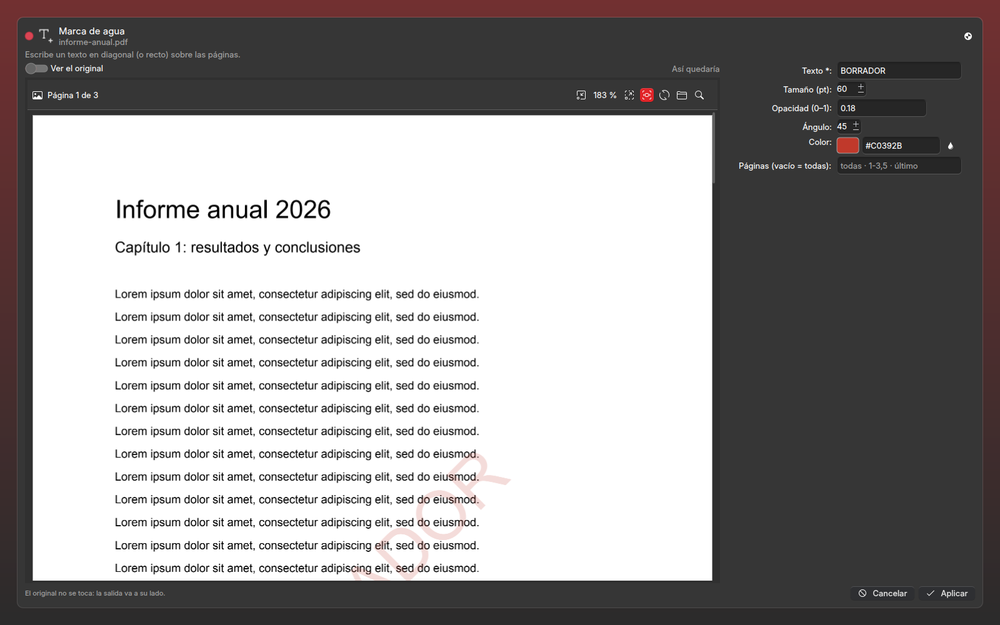
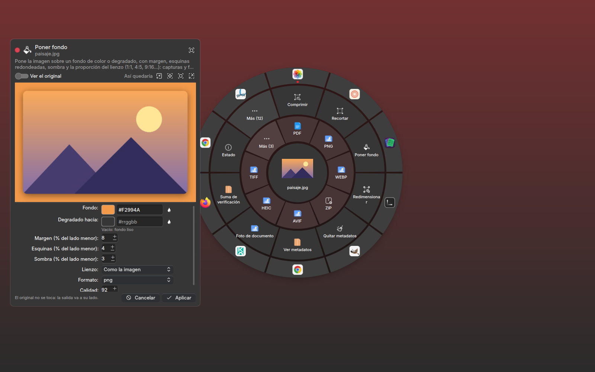
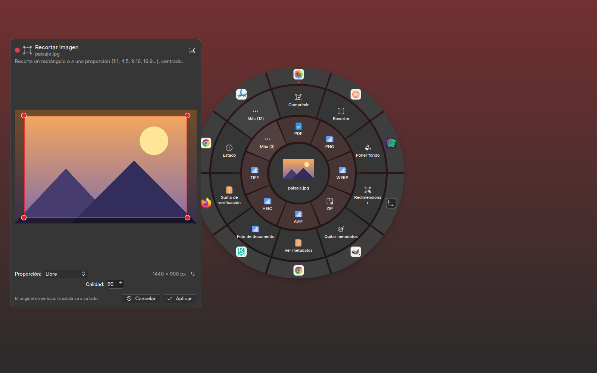
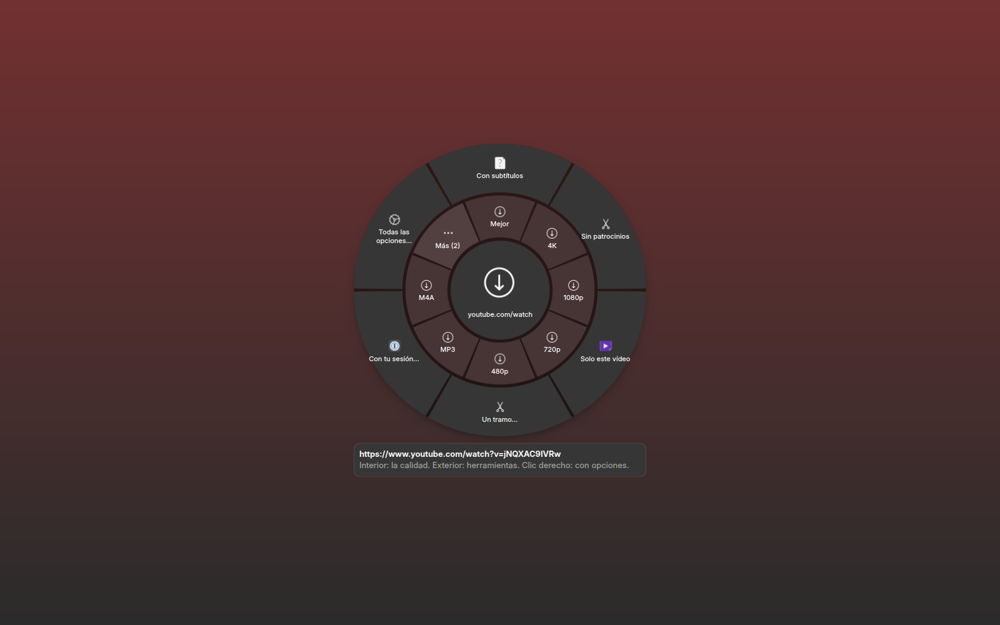
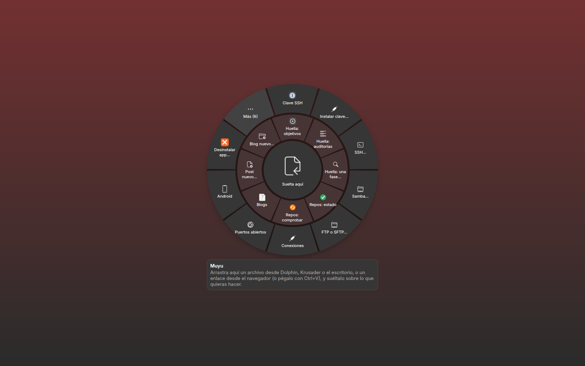

# muyu/ — Muyu, la rueda universal del escritorio: abrir con, convertir y las herramientas de tus programas



## Qué es

**Muyu** («círculo, giro» en quechua) es una rueda para el escritorio KDE Plasma (Wayland y X11). Haces doble clic en
un archivo —Muyu es la aplicación predeterminada—, lo sueltas sobre ella o la llamas con un atajo, y aparece un
círculo bajo el puntero con todo lo que se puede hacer con ese archivo, esa carpeta o ese enlace en tu máquina:

- **afuera, «Abrir con…»**: las aplicaciones que tu sistema conoce para ese tipo; la de siempre va primero y la abre
  **Intro** (el doble clic de siempre, a una tecla);
- **interior, «Convertir a»**: los formatos de destino (PDF, DOCX, JPG, PNG, WebP, MP3, SRT, Markdown…);
- **exterior, «Herramientas»**: comprimir, OCR, tachar, marca de agua, metadatos, recortar, poner fondo, rotar,
  transcribir con Whisper, descargar de YouTube y más de mil sitios, sumas de verificación, cifrar con GPG, montar una
  ISO, SSH, Android… página a página con «Más».

El resultado queda en el centro: lo arrastras a Dolphin o al escritorio, o sigues trabajando con él (un PDF a JPG, y
el JPG a recortar). Nada toca el original: cada salida va a su lado.

| | |
|---|---|
|  |  |
| **Vista previa en vivo**: la operación de verdad sobre una copia, en el visor de PDF (zoom, búsqueda, selección) | **Opciones generadas de cada herramienta**, con su vista previa |
|  |  |
| **Editores a la vista** (el recorte, en píxeles reales de la foto) | **Enlaces**: suelta o pega uno y elige la calidad; con avance real |



## Lo que la hace distinta

- **Una rueda para todo**: tres anillos (abrir con, convertir, herramientas), con páginas, para cualquier tipo:
  documentos, PDF, imágenes, audio, vídeo, subtítulos, comprimidos, ISO, paquetes, scripts, carpetas y enlaces.
- **Aplicación predeterminada que no te quita nada**: Intro abre con la aplicación de antes; `--quitar` devuelve cada
  tipo a la suya (y antes de tomarlos respalda tu `mimeapps.list`).
- **Vista previa de verdad** antes de aplicar, y editores a la vista (recorte), con el formulario generado de cada
  herramienta.
- **Encadenar** sin soltar el resultado; **deshacer** a la papelera.
- **Integrada con KDE**: Dolphin y Krusader («Abrir en Muyu…»), Okular (el documento y la página que estás leyendo),
  LibreOffice (una macro), el atajo **Meta+Ctrl+R** a mitad de un arrastre, una franja en el borde de cada pantalla,
  varios monitores (aparece en el del puntero), layer-shell en Wayland, notificaciones, el tema de Plasma.
- **No reinventa nada**: cada herramienta la hace el programa que la sabe hacer, por su CLI (proveedores).

## Uso

```bash
./run.sh archivo.pdf foto.jpg                          # la rueda con esos archivos en el centro
./run.sh "https://youtu.be/…"                          # la rueda de descargas de un enlace
./run.sh                                               # vacía, bajo el puntero (lo que hace el atajo Meta+Ctrl+R)
./run.sh --residente                                   # se queda con una franja en el borde de cada pantalla
./run.sh --instalar --residente --predeterminada -n    # qué pondría en KDE; sin -n, lo pone
./run.sh --quitar                                      # lo quita y devuelve a cada tipo su aplicación de antes
./run.sh --opciones carpeta/                           # lo que ofrecerían los proveedores, en texto
```

En la rueda: clic o soltar encima corre; clic derecho abre las opciones; ← → recorren; Intro abre con la de siempre o
corre lo elegido; Ctrl+V pega un enlace o archivos; Retroceso vuelve; Ctrl+Z deshace; Esc cierra.

## Instalación

En Kubuntu o Ubuntu con KDE Plasma 6 (las demás distribuciones, con los mismos paquetes de su nombre):

```bash
sudo apt install python3-pyside6.qtquick python3-pyside6.qtqml python3-pyside6.qtquickcontrols2 \
    python3-pyside6.qtdbus python3-pyside6.qtnetwork python3-pyside6.qtwidgets python3-yaml \
    qml6-module-org-kde-kirigami qml6-module-org-kde-layershell
git clone https://github.com/achalmed/gui-comun     # el marco común de la ventana
git clone https://github.com/achalmed/muyu
git clone https://github.com/achalmed/raphi && raphi/install.sh   # opcional: convertir y las herramientas de documentos y medios
muyu/run.sh --instalar --residente --predeterminada -n            # mira qué pondría; sin -n, lo pone
```

Muyu encuentra gui-comun y Raphi en carpetas hermanas (o por `GUI_COMUN_DIR`, `MUYU_RAPHI_DIR`). Lo que una
herramienta necesita y no está (`gpg`, `adb`, `xorriso`, `qemu`, `mat2`, `yt-dlp`…), la rueda lo dice en su sector.

## Estructura

| carpeta | qué es |
|---|---|
| `muyu/` | el paquete sin Qt: `rutas.py` (cada proyecto por el manifiesto o al lado), `anillos.py` (qué va en cada anillo y sus páginas), `instalar.py` (KDE, la predeterminada y su vuelta), `proveedores/` |
| `muyu/proveedores/` | `raphi` (el motor de Raphi por su corredor), `abrir` («Abrir con…»), `studios` (las herramientas de los studios del autor por su CLI), `sistema` (red, ISO, seguridad, Android, copias, búsquedas, sistema) |
| `escritorio/` | la ventana: `aplicacion.py` (instancia única, layer-shell), `controlador.py` (`Rueda`), `qml/` |
| `tests/` | las pruebas (`tests/run.sh`) |
| `scripts/escanear.py` · `demo/demo.conf` | la guarda del repositorio público (nada privado sale en un envío) |

Un proveedor nuevo es un módulo con `opciones(rutas)` y `preparar(sector, params, archivos)`: ver `CLAUDE.md`.

## Límite honesto

- **Wayland no deja ver un arrastre que empieza en otro programa**: la rueda se llama (doble clic, menú de Dolphin y
  Krusader, el atajo a mitad del arrastre, la franja del borde).
- **El atajo** que pone `--instalar` lo toma KDE al volver a entrar en la sesión (antes, en Preferencias del sistema).
- **Los studios** (Filesystem, Git, LaTeX, Quarto y Huella Studio) son programas del autor: sin ellos, su anillo no
  aparece y lo demás funciona igual. MEGA no está.
- La interfaz está en español.

## In English

**Muyu** is a radial launcher for KDE Plasma (Wayland and X11): double-click any file (Muyu can be the default
application), drop it on Muyu or call it with a shortcut, and a wheel appears under the pointer with **every app that
can open it** (your usual one first: press Enter), **every format it converts to** (PDF, DOCX, JPG, MP3, SRT…) and
**every tool** that applies: compress, OCR, redact, watermark, metadata (mat2), crop with a visual editor, background,
rotate, Whisper transcription, downloads from YouTube and 1000+ sites (yt-dlp, with real progress and your browser
cookies), checksums, GPG, ISO mount/burn/QEMU test, SSH/SFTP/Samba, Android (adb), backups, search, system info —
inspired by KDE-Services, Metadata Cleaner and Video Downloader, and going further. Live previews run the real
operation on a copy; results can be dragged out to Dolphin or chained; undo goes to the trash; nothing touches the
original. It integrates with Dolphin and Krusader, Okular (current document and page), LibreOffice (macro), multiple
monitors and layer-shell. The interface is in Spanish; contributions are welcome. License: AGPL-3.0.

## Licencia

[AGPL-3.0](LICENSE).
